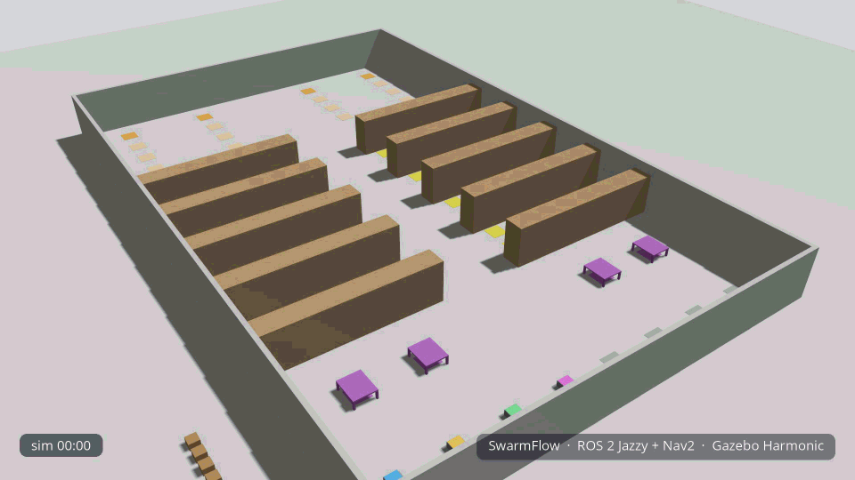
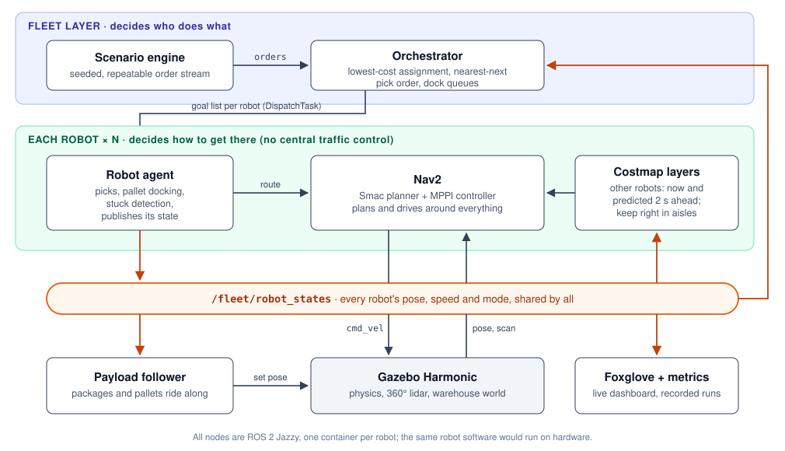
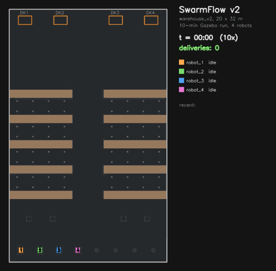

# SwarmFlow

**Warehouse robot fleets that deploy without a grid: no QR codes on the floor, no tape, no central traffic
controller. Robots navigate free space on a lidar map and coordinate with each other: they share where they will be
and when, yield to whoever reserved the way first, and untangle their own deadlocks.**

A digital twin with real robot software (ROS 2, Nav2) in a simulated Gazebo warehouse. The whole warehouse is one
layout file, so changing the floor plan means regenerating the map, not re-laying a floor.


[](docs/evidence/swarmflow_3d_demo.mp4)

*A real Gazebo run, filmed by three cameras in simulation time, with each robot's last 20 s of path drawn in its
colour: four robots pick shelf orders in the aisles (a box appears on the robot at each pick), and one drives under a
pallet, lifts it, carries it to a truck dock and sets it down centred on the dock pad. Reserved trajectories, the
deadlock breaker and the smoothing profile are on.
**[Watch the full 1080p video](docs/evidence/swarmflow_3d_demo.mp4)** (67 s: 9 orders, one of them a pallet, delivered in
6 sim minutes; robots never closer than 0.25 m).*

---

## Why it matters

Grid-based warehouse robots (QR-code floors like Kiva's, magnetic tape, reflectors) need floor infrastructure before
the first robot moves. Vendors quote about 8–16 weeks to install and commission guided AGV paths, against about 2–6
weeks for infrastructure-free robots ([1](https://www.evsint.com/autonomous-mobile-robots-vs-agvs/),
[2](https://afs.gogcg.com/blog/agvs-vs-amrs); indicative vendor figures). The price of dropping the grid is
coordination: robots that share free space have to avoid each other, and they can jam.

## The question

> *How far can decentralised, infrastructure-free coordination (prediction, reserved trajectories, yielding) go
> toward the throughput and safety of a centrally scheduled fleet, and does it beat robots that navigate
> independently?*

SwarmFlow is built to answer that with measurements, not demos. Every scenario is seeded and repeatable, every run
starts from fresh containers, and every metric is computed from the recorded robot states.

## Highlights

| | |
|---|---|
| **2× throughput from coordination** | In a shared narrow corridor, coordinated robots delivered **7.0** orders vs **3.3** for independent navigation (v1, n = 3). |
| **Prediction prevents jams** | Robots that predict where the others will be in 2 s delivered **13.3** orders per busy 10 minutes vs **11.0** without, with **0** failed orders in all 3 runs; without prediction, one run jammed four robots at once. |
| **Crowded fleets don't jam** | With 5 robots in the same warehouse, reserved trajectories plus a deadlock breaker delivered **17.0** orders per 10 minutes with **0** failed orders, against **11.0** and 7 failed with the coordination off (2 runs each). |
| **Smoother motion** | Realistic acceleration limits cut heading jerk by **21 %** and acceleration by **17 %**, measured from wheel odometry at 20 Hz, and gave the steadiest throughput: 13 / 13 / 14 deliveries, 0 failed. |
| **Almost no contact** | Robots keep apart with no traffic controller: across 6 busy 10-minute runs with 4 robots, two bodies touched once, by 2 cm. |
| **Precise pallet handling** | Robots drive under pallets, lift, carry and set them down: **8 / 8** deliveries, **0.0 cm** sideways docking error. |
| **Runs on a laptop** | `docker compose up` on Windows brings up Gazebo, 4 Nav2 robots, the fleet layer and a Foxglove dashboard. A light mode runs **8 robots in 0.6 of a CPU core**. |
| **Honest science** | Every idea is tested in Gazebo against a decision rule fixed before the first run, at matched CPU load. Ideas that failed are published with the reason (a stop-in-place yield, three anti-jamming controllers, moving pick points, a first smoothing profile). |

## How it works



- **The fleet layer decides *who does what*.** Each order goes to the robot with the lowest cost: travel distance
  plus a congestion penalty for robots already heading to the same spot. Pick lists are ordered nearest-next. Each
  dock has a queue lane, and a robot claims its place in it only when it arrives at the line, so places go first
  come, first served.
- **Each robot decides *how to get there*.** Every robot stamps the others into its own costmap: their footprints
  now, and where they will be over the next 2 seconds. It keeps right in every aisle and plans around everything
  else itself. There is no central traffic control, and avoidance keeps working if the fleet layer goes down.
- **Robots reserve their trajectories.** Each robot publishes its planned path timed along the way, stamped with when
  it reserved it. A robot yields only to an older reservation that it would meet at a similar time, and it waits
  somewhere clear of that robot's path (never in it, never inside a dead-end aisle). Because priority is a total
  order, waiting can never form a cycle.
- **Deadlocks are found and broken.** Every robot builds the same "who waits for whom" graph from the shared states.
  A cycle of any size that lasts 8 s is broken one robot at a time, lowest priority first: it backs up along the path
  it just drove, only if nobody is behind it.
- **Same software as a real robot.** ROS 2 Jazzy and Nav2 (Smac planner, MPPI controller), a custom differential-drive
  chassis with a 360° lidar, physics in Gazebo Harmonic.

## Engineering highlights

Problems found and solved along the way, each with evidence in the repo:

- **Robots were invisible to each other.** Every robot's lidar sits in a slot at the same height, so a scan passes
  straight through the other robots. The fix: a custom C++ Nav2 costmap layer that draws other robots from their
  shared, predicted states.
- **Nav2 was silently ignoring its parameters.** In composed mode, the costmap sub-nodes never received their
  parameter file and ran on Nav2 defaults. Found by checking parameters inside the running stack, fixed in the launch
  file.
- **A test-harness bug skewed the benchmarks.** Docker services behind compose profiles survived `compose down` and
  carried state between runs. It was caught by comparing container uptimes; the harness was fixed and all 14 affected
  runs were redone.
- **The visualisation used too much CPU.** Profiling showed most of its time went into decoding route plans, so the
  node now reads coordinates straight from the serialized bytes: **15× faster** per plan, tested byte-for-byte
  against ROS's own decoder.
- **Stalls depend on CPU pressure.** The same code gave 4–21 stuck episodes per run at normal load and 23–49 on an
  overloaded host. Every run now records its CPU load, and only runs at matching load are compared.

## Results



*Top-down replay of a full 10-minute run at 10×, drawn from the recorded robot states: five robots with reserved
trajectories and the deadlock breaker (run `g068_1`; smoothing was off in that run), 17 orders unloaded at their
docks, 0 failed, no physical contact. "yielding" marks a robot waiting clear of an older reservation
([full-quality video](docs/evidence/v2_demo_replay_g068_1.webm)).*

| Setup | Robots | Deliveries / 10 min | Stuck / failed | Closest approach (padded footprints) |
|---|---|---|---|---|
| v1: central reservations, standard layout | 3 | 15.0 ± 0.0 | 0 / 0 | −0.05 ± 0.15 m |
| v2: robots coordinate locally, with prediction | 4 | 13.3 ± 2.1 | 0 / 0 | −0.02 ± 0.04 m |
| v2: robots coordinate locally, without prediction | 4 | 11.0 ± 2.0 | 1.3 / 1.3 | −0.07 ± 0.04 m |
| v2 + dock line (places claimed on arrival at the line) | 4 | 13.3 ± 3.8 | 1.0 / 1.0 | −0.06 ± 0.05 m |
| v2.2, coordination off, matched load (`o069_*`) | 4 | 11.3 ± 3.5 | 2.0 / 2.0 | −0.07 ± 0.02 m |
| v2.2 + smoothing + deadlock breaker | 4 | 13.3 ± 0.6 | 0 / 0 | −0.08 ± 0.02 m |
| v2.2 + reserved trajectories + deadlock breaker | 4 | 12.3 ± 2.3 | 0.7 / 0.7 | −0.06 ± 0.07 m |
| v2.2, coordination off | 5 | 11.0 | 3.5 / 3.5 | −0.08 m |
| **v2.2 + reserved trajectories + deadlock breaker** | 5 | **17.0** | **0 / 0** | −0.05 m |

v2 deliveries count only orders unloaded at their dock. An agent bug, found and fixed with the dock line (a
preempted Nav2 goal reported as succeeded), had ended some tasks at their last pick, and the earlier v2 tables counted
1–2 such orders per run as delivered; the rows above are recounted from the raw runs (published before: 14.7 and
12.7). Footprints are padded 5 cm per side, so bodies touch only below −0.10 m. v2 orders are harder (1–3 picks plus a dock 20–30 m away; about 1 in 9 is a pallet move), and v2 robots wait 21–31 s
per run instead of 55 s behind v1's aisle holds. Full tables: [v2 benchmarks](docs/results/v2_benchmarks.md),
[realism ladder](docs/results/v2_realism_ladder.md) (localisation error, network delay and loss, lidar noise),
[v1 baseline](docs/results/v1_baseline.md).

**v2.2** (reserved trajectories, deadlock breaker, smoother motion): the v2.2 rows run with a smoothness probe in
one container, so they are compared only with each other (matched CPU load). The pre-registered rule was met with 5
robots; with 4, each setting had one marginal contact against none for the control (none caused by the features),
and the project owner adopted all three as defaults on the full numbers.
[Write-up](docs/results/v2_benchmarks.md#reservations-deadlock-breaker-smoother-motion-t066t070-2026-10-1920).
Earlier experiments (v2.1 anti-jamming, a stop-in-place yield, moving pick points) did not pass and are written up
in the same file.

## Run it

Windows 11 with Docker Desktop (WSL2), about 20 GB of disk. A cold build takes about 10 minutes.

```powershell
git clone https://github.com/ef-73/SwarmFlow.git
cd SwarmFlow
docker compose up
```

Then open Foxglove on `ws://localhost:8765`. To run the v2 warehouse with 4 robots, set `SWARMFLOW_LAYOUT=warehouse_v2`,
`SWARMFLOW_POLICY=assign`, `SWARMFLOW_SCENARIO=v2_demo`, `SWARMFLOW_ROBOTS=robot_1,robot_2,robot_3,robot_4` and
`SWARMFLOW_TRAFFIC_CONTROL=false`. Headless measured run:
`tests/integration/demo_run.sh <id> 10 v2_demo assign 0`.

Everything else (Gazebo window, configuration, experiments, architecture, limitations) is in the
**[full usage guide](docs/USAGE.md)**.

## How it was built

Built in 8 days, from an empty repository to v2.1, with a contract-first, test-gated process:

- **Contracts first.** Message types, the layout schema and the fleet-layer API were frozen before parallel work
  began; changes need an explicit, written decision ([decisions](docs/decisions/)).
- **A referee, not trust.** One CI script ([`scripts/ci.sh`](scripts/ci.sh)) checks frozen contracts, hygiene, the
  build and **315 tests** on every change. Nothing reaches `main` red.
- **AI-assisted.** Most code was written by AI coding agents working in parallel against tests written up front; the
  project owner set direction, made the design calls and reviewed every release.

Design: [`docs/design.md`](docs/design.md). Contributing: [`CONTRIBUTING.md`](CONTRIBUTING.md).

## Repository map

| Path | What it holds |
|---|---|
| `src/swarmflow_core/` | Fleet layer as a pure-Python library (assignment, costs, decisions); no ROS dependency |
| `src/swarmflow_nav/` | Nav2 bringup and the C++ costmap layers (other robots with prediction, keep-right lanes) |
| `src/swarmflow_robot_agent/` | Per-robot agent: goals, picks, pallet docking, stuck detection |
| `src/swarmflow_viz/`, `viz/` | Foxglove scene and dashboard, Gazebo overlay |
| `layouts/`, `tools/layoutgen/` | Warehouse layouts generated from one definition (world, map, nav graph) |
| `sim2d/` | Light mode: the same fleet logic without Gazebo |
| `tools/metrics/` | Metrics, replay data and video rendering |
| `tests/`, `scripts/ci.sh` | Fixtures, unit and integration tests, the CI referee |

## License

MIT, see [`LICENSE`](LICENSE).
